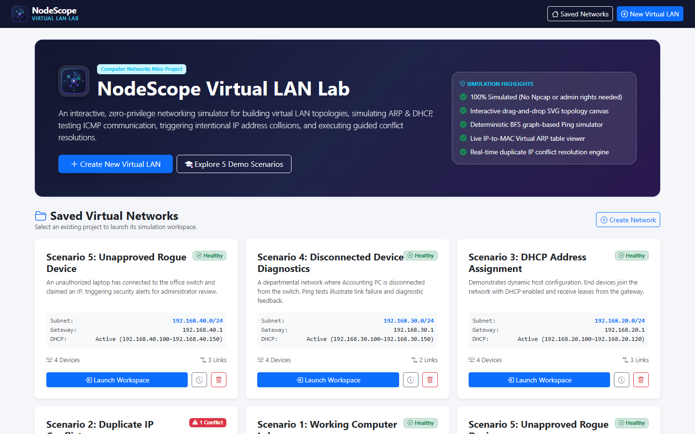
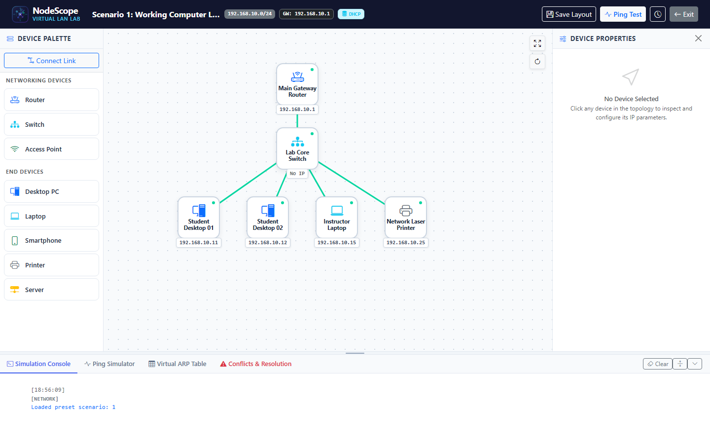
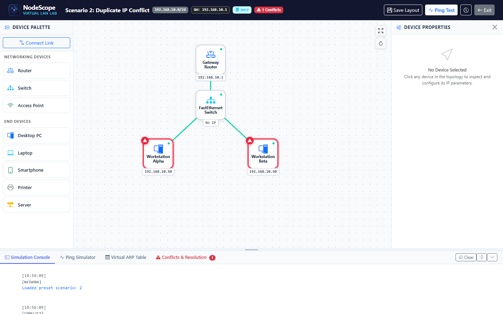
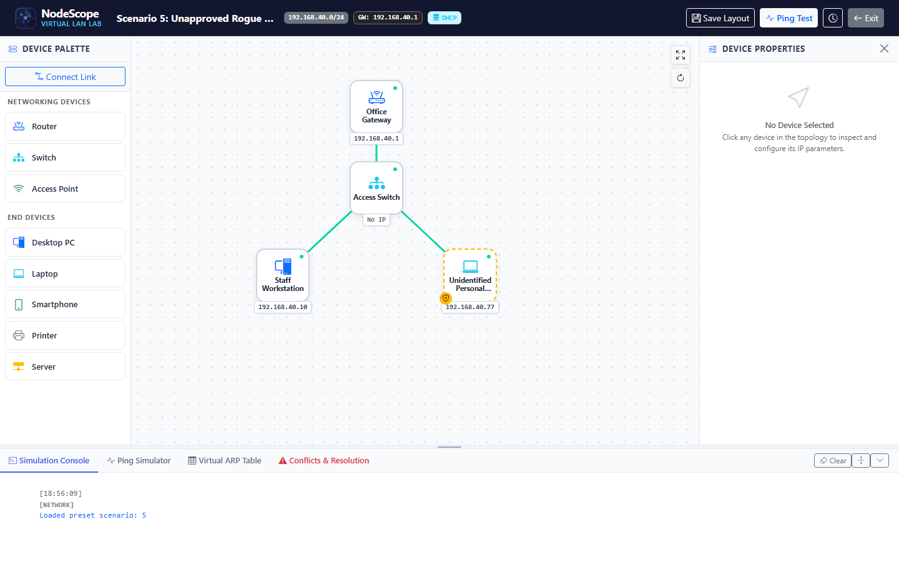
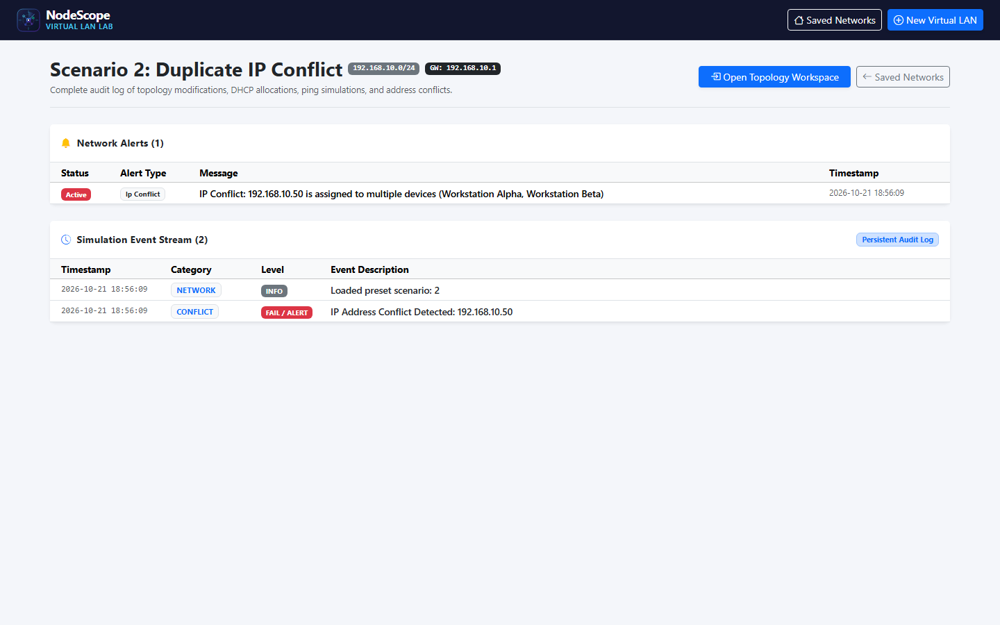

# NodeScope — Interactive Virtual LAN Simulator & Troubleshooting Lab

<div align="center">


### A Complete Simulation-Based Computer Networks Laboratory & Engineering Mini-Project
*Built with Python 3, Flask, SQLite, HTML5, CSS3, Bootstrap 5, and SVG Vector Graphics*

[](https://www.python.org/)
[](https://flask.palletsprojects.com/)
[](https://www.sqlite.org/)
[](tests/)
[](docs/NodeScope_Project_Report.pdf)
[](docs/PRESENTATION_SCRIPT.md)
[](docs/ARCHITECTURE.md)
[](docs/LAB_MANUAL.md)
[](LICENSE)

</div>

---

 Project Overview

**NodeScope** is a fully simulation-based virtual Local Area Network (LAN) design, configuration, and troubleshooting platform. Developed specifically for **Computer Engineering and Information Technology students and instructors**, it allows users to visually assemble LAN topologies, configure IPv4 subnetting and dynamic DHCP services, run deterministic Layer 3 ICMP ping diagnostics, analyze Layer 2 to Layer 3 mappings in a Virtual ARP Table, and troubleshoot real-time IP address collisions with an intelligent **Guided Conflict Resolver**.

> [!IMPORTANT]
> **100% Simulation-Driven:** NodeScope requires **no physical network scanning**, **no raw sockets**, **no Scapy/Npcap/WinPcap**, and **no administrator privileges**. All networking rules are evaluated deterministically using standard library Python networking logic (`ipaddress`), graph traversal algorithms (Breadth-First Search), and relational SQLite persistence.

---

 Visual Tour & Application Screenshots

### Welcome Dashboard & Scenario Launcher
Select from 5 pre-packaged educational scenarios, open saved networks, or create custom IPv4 private LANs with full CIDR subnet and DHCP pool validation.



---

### Interactive 3-Panel Topology Workspace
Features an intuitive SVG-powered drag-and-drop canvas, a comprehensive device palette (Routers, Switches, PCs, Laptops, Phones, Servers), and a dedicated Device Properties Inspector with unclipped power/access controls and dynamic subtext.



---

### Real-Time IP Address Collision Detection & Halos
When two active interfaces share an identical IPv4 address, NodeScope instantly flags the collision with pulsing red halos, an alert counter, and an ambiguous Virtual ARP Table entry.



---

### Rogue Device Detection & Security Access Control
Unauthorized hardware connected to the network is instantly highlighted with a yellow dashed warning border and shield alert icon, enabling network security triage and administrator authorization.



---

### Persistent Activity Audit & Event Stream
Every network event—DHCP lease grants, link modifications, ICMP ping probes, IP collisions, and security alerts—is recorded with microsecond timestamps for historical audit.



---

 Core Modules & Capabilities

| Module | Technical Capabilities |
| :--- | :--- |
| **1. Network Management** | Create virtual LAN projects with custom CIDR subnets (e.g. `192.168.10.0/24`), netmasks, default gateways, and configurable DHCP pools (`192.168.10.100`–`192.168.10.150`). Persists across restarts in SQLite. |
| **2. Interactive Topology Workspace** | 3-panel workspace: Left Device Palette & Topology Builder, Centre SVG Canvas, Right Device Inspector. Smooth 60fps link dragging, node selection, and zoom/center controls. |
| **3. Automated Topology Generator** | Instant 1-click builder for standard network architectures: Star, Bus, Ring, Mesh, Hierarchical Tree, and Hybrid topologies with mathematically computed layout coordinates. |
| **4. Routing Algorithm Engine** | Simulates Dijkstra / OSPF (Link-State SPF), Bellman-Ford Distance Vector (with Split Horizon and Poison Reverse options), RIP (15-hop limit boundary), and BFS Minimum Hops. Displays router FIB tables and LSDB link-state matrices. |
| **5. End-to-End Packet Simulator** | Hop-by-hop transmission engine for DATA (UDP), ICMP Ping, and TCP SYN packets. Renders real-time SVG animated packet travel, latency breakdown, and failure diagnostics. |
| **6. Link Fault Injection & Rerouting** | Click any link to inspect metrics or sever the link (`status='down'`). Watch packets immediately drop or dynamically discover alternate redundant paths in Mesh and Ring topologies! |
| **7. Device Inventory & Palette** | Add End Devices (Laptops, Desktops, Phones, Printers, Servers) and Networking Infrastructure (Routers, Core Switches, Wireless APs). Automatically assigns IEEE-compliant unicast MACs (`02:xx:xx:...`). |
| **8. Static & DHCP Addressing** | Configurable IP allocation mode. Supports static assignment with duplicate detection, as well as a virtual DHCP server that allocates sequential leases, tracks renewals/releases, and flags pool exhaustion. |
| **9. IP Conflict Detection & Guided Resolver** | Automatically detects when >= 2 active hosts share an IPv4 address. Highlights nodes, flags ambiguous ARP entries, computes free candidate IPs in the subnet, and applies real-time database reconfigurations. |
| **10. Virtual ARP Table** | Educational Layer 2 (MAC) to Layer 3 (IP) resolution table displaying dynamic bindings and flagging ambiguous mappings caused by IP collisions. |
| **11. Resizable Simulation Console** | Collapsible to a compact 38px tab bar or expandable up to 500px using a vertical mouse drag handle, keeping logs constrained to internal scrollbars. |

---

 Documentation & Laboratory Guides

To assist students and educators during project reviews, viva examinations, and lab demonstrations, comprehensive documentation is provided:

- 📄 **[Comprehensive Project Report (PDF)](docs/NodeScope_Project_Report.pdf)**: Complete academic report with executive summary, comparative study, system architecture, database design, visual screenshots, testing analysis, and viva defense guide.
- 🗣️ **[Viva Voce Presentation Script for "Sir"](docs/PRESENTATION_SCRIPT.md)**: Spoken step-by-step presentation script with screen action cues, talking points, and answers to high-frequency professor questions.
- 📐 **[System Architecture & Simulation Specification](docs/ARCHITECTURE.md)**: In-depth breakdown of the MVC pattern, relational SQLite schema, BFS graph algorithms, and DHCP state machine.
- 📖 **[Laboratory Manual & 20 Viva Questions](docs/LAB_MANUAL.md)**: 4 full student lab experiments with procedures, expected outputs, and 20 essential Computer Networks oral viva questions with complete technical answers.
- 🔌 **[REST API Reference](docs/API_REFERENCE.md)**: Detailed JSON schema and request/response examples for all 16 Flask REST API endpoints.

---

## 5. Technology Stack

- **Backend:** Python 3.11+ / Python 3.14, Flask 3.x
- **Database:** SQLite via Python's built-in `sqlite3` (parameterized queries, foreign keys, and indexes)
- **Networking Logic:** Python built-in `ipaddress` module
- **Testing:** Pytest 8.x, pytest-flask
- **Frontend:** HTML5, CSS3, Bootstrap 5, Bootstrap Icons, Vanilla JavaScript, SVG Vector Graphics
- **Zero Heavy Build Tools:** No Node.js, Webpack, npm, React, or TypeScript needed. Starts with a single Python command!

---

## 6. Architecture & Project Structure

```text
NodeScope/
├── app.py                      # Application entry point & factory
├── requirements.txt            # Minimal dependencies (Flask, Pytest)
├── README.md                   # Main documentation & visual tour
├── docs/                       # Project documentation & assets
│   ├── NodeScope_Project_Report.pdf # Formatted academic project report (PDF)
│   ├── PRESENTATION_SCRIPT.md  # Viva presentation script & cues for "Sir"
│   ├── ARCHITECTURE.md         # System architecture & simulation algorithms
│   ├── LAB_MANUAL.md           # Student lab manual & 20 viva Q&As
│   ├── API_REFERENCE.md        # Complete REST API reference
│   └── screenshots/            # High-resolution application screenshots
├── database/
│   ├── db.py                   # SQLite connection pooling & initialization
│   └── schema.sql              # Normalized relational schema (6 core tables)
├── simulator/                  # Pure Python simulation & networking engine
│   ├── addressing.py           # CIDR calculations, IP/MAC validation & candidate discovery
│   ├── dhcp.py                 # Virtual DHCP pool allocator & lease lifecycle
│   ├── connectivity.py         # BFS graph traversal for topological link paths
│   ├── conflicts.py            # Duplicate IP detection & real-time resolution
│   ├── ping.py                 # Deterministic ICMP Ping diagnostic engine
│   ├── arp.py                  # Virtual ARP resolution & collision table
│   ├── events.py               # Activity audit logging & alert triage
│   └── scenarios.py            # 5 Pre-packaged educational presentation setups
├── routes/
│   ├── views.py                # HTML routes: Welcome (/), Workspace (/workspace/<id>), History (/history/<id>)
│   └── api.py                  # 16 REST JSON API endpoints for canvas operations
├── templates/
│   ├── base.html               # Master layout with NodeScope logo & global creation modal
│   ├── index.html              # Welcome screen, saved networks & scenario launcher
│   ├── workspace.html          # Central interactive topology workspace & tools
│   └── history.html            # Event audit stream & security alerts history
├── static/
│   ├── css/nodescope.css       # Custom cyber-indigo design tokens & layout rules
│   ├── js/workspace.js         # Vanilla JS drag-and-drop & SVG connection engine
│   └── img/                    # NodeScope vector logo & favicons
├── scripts/
│   └── capture_screenshots.py  # Headless browser automated screenshot capture script
└── tests/                      # Automated Pytest suite (18 unit & integration tests)
```

---

## 7. Getting Started on Windows (VS Code)

### Prerequisites

- **Python 3.11 or newer** installed ([python.org](https://www.python.org/downloads/)). Check "Add Python to PATH" during installation.
- **Git** installed ([git-scm.com](https://git-scm.com/)).
- **VS Code** (recommended editor).

### Step 1: Clone Repository & Open Directory

```powershell
git clone https://github.com/Kavishkhan15/NodeScope.git
cd NodeScope
```

### Step 2: Create & Activate Virtual Environment

```powershell
python -m venv venv
.\venv\Scripts\Activate.ps1
```

*(If PowerShell script execution is restricted, run: `Set-ExecutionPolicy -ExecutionPolicy RemoteSigned -Scope Process`)*

### Step 3: Install Dependencies

```powershell
pip install -r requirements.txt
```

### Step 4: Run the Application

```powershell
python app.py
```

Open your browser and navigate to:  
👉 **`http://127.0.0.1:5000/`**

---

## 8. Running the Automated Test Suite

Run the complete automated test suite:

```powershell
pytest
```

Output:
```text
============================= test session starts =============================
platform win32 -- Python 3.14.0, pytest-8.3.5
collected 18 items

tests\test_sim_addressing.py .........                                   [ 50%]
tests\test_sim_api.py .                                                  [ 55%]
tests\test_sim_arp.py .                                                  [ 61%]
tests\test_sim_conflicts.py .                                            [ 66%]
tests\test_sim_connectivity.py .                                         [ 72%]
tests\test_sim_devices.py .                                              [ 77%]
tests\test_sim_dhcp.py .                                                 [ 83%]
tests\test_sim_events.py .                                               [ 88%]
tests\test_sim_ping.py .                                                 [ 94%]
tests\test_sim_scenarios.py .                                            [100%]

============================= 18 passed in 1.27s ==============================
```

---

## 9. Educational Presentation & Viva Demonstration Scenarios

NodeScope comes pre-loaded with **5 ready-made demonstration scenarios** designed for live classroom and viva evaluations:

| Scenario | Objective & What to Demonstrate |
| :--- | :--- |
| **Scenario 1: Working Computer Lab** | A standard healthy star topology (Gateway router, central switch, 2 workstations, laptop, printer). Demonstrate opening the **Ping Simulator**, selecting Workstation 1 → Workstation 2, and observing the successful ICMP reply and BFS path trace (`PC1 → Switch → PC2`). |
| **Scenario 2: Duplicate IP Conflict** | Workstation Alpha and Beta are both assigned static IP `192.168.10.50`. Show the pulsing red collision halo on the canvas. Open the **Conflicts & Resolution** tab, click **Guided Resolution**, select Workstation Beta, review the suggested candidate IP (`192.168.10.2`), and click **Apply Resolution**. Witness the conflict immediately clear and the ARP table return to normal. |
| **Scenario 3: DHCP Dynamic Leases** | Demonstrates dynamic host configuration over a Wireless Access Point. Show dynamic address assignment from the pool, inspect the leases, and demonstrate releasing/renewing leases. |
| **Scenario 4: Disconnected Device Diagnostic** | Workstation 2 is physically disconnected from the departmental switch. Demonstrate running a ping and explaining why it fails (`No active physical or wireless link connects...`). Use the **Connect Link** tool to bridge the cable, re-ping, and show instant recovery. |
| **Scenario 5: Unapproved Rogue Device** | An unauthorized personal laptop attaches to the LAN. Demonstrate security triage: observe the yellow dashed unapproved badge, inspect the security alert, and perform administrator approval. |

---

## 10. Step-by-Step Viva Demonstration Script

1. **Launch & Motivation:**
   - Run `python app.py` and open `http://127.0.0.1:5000/`.
   - Explain that physical LAN testing is costly and hard to observe; NodeScope gives students a visual window into ARP, DHCP, and packet forwarding without hardware constraints.
2. **Build a Network:**
   - Click **Create New Virtual LAN** (`192.168.10.0/24`, gateway `192.168.10.1`, DHCP pool `192.168.10.100`–`150`).
   - Add a switch, desktop, and laptop. Connect them with the **Connect Link** tool.
3. **Verify DHCP & Ping:**
   - Inspect the desktop to show it received `192.168.10.100`.
   - In the bottom console, open **Ping Simulator**, run Desktop → Gateway Router, and demonstrate the 5-step diagnostic breakdown.
4. **Trigger & Resolve IP Collision:**
   - Configure the laptop with static IP `192.168.10.100`.
   - Show the instant **pulsing red conflict halos** and the `AMBIGUOUS` ARP table entry.
   - Click **Launch Guided Conflict Resolution**, apply the recommended IP (`192.168.10.2`), and show the instant recovery back to healthy green.
5. **Review Audit Logs:**
   - Navigate to **Activity History** to show that all events, lease grants, and conflict resolutions are permanently recorded with timestamps.

---

## 11. License

Developed for academic and educational demonstration purposes under the **MIT License**.
